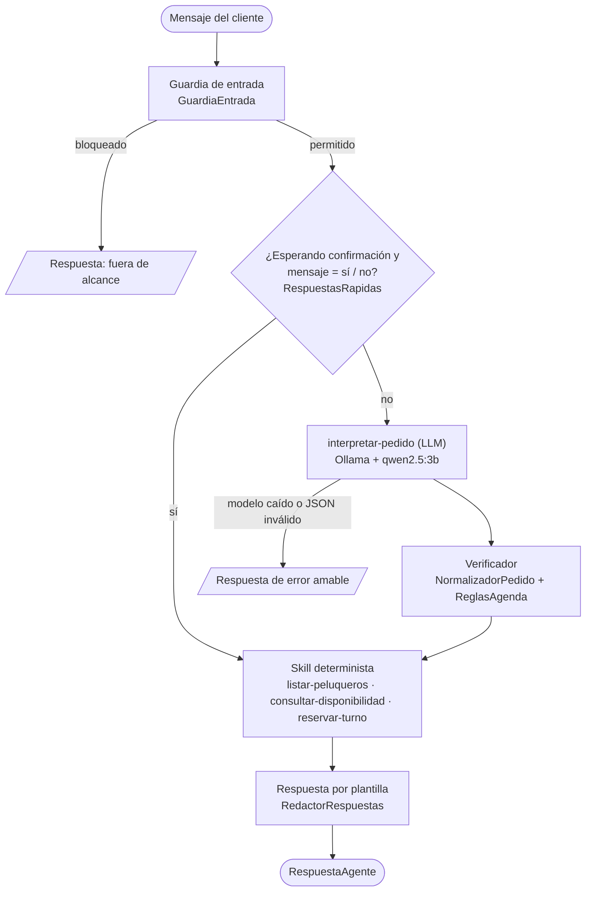

# Peluquería Agente

Agente recepcionista de peluquería con skills declarativas (Spring AI + Ollama).

## Contexto

Proyecto del **Portfolio 2** de la materia *Programación con IA generativa* (Universidad de Palermo).

La primera versión era un chatbot por **menú numerado**: el cliente tenía que escribir "1" para reservar, elegir el peluquero por número, después "1" para hoy o "2" para mañana.
Esta versión es un **agente que entiende lenguaje natural**: el cliente escribe
«quiero un turno con Santiago el sábado a las 16» y el agente lo interpreta, verifica y reserva.
El modelo corre en local con Ollama, sin enviar datos a servicios externos.

## Cómo funciona

El principio de diseño es **«el modelo propone, el código verifica»**. El modelo de lenguaje solo
convierte el mensaje en un JSON (intención, peluquero, fecha, hora). Cada dato se contrasta con el
mensaje y con las reglas de la agenda antes de usarse. Las respuestas salen de plantillas, no del modelo.



La orquestación está en `AgenteRecepcionista`. La conversación es una máquina de estados
(`EstadoConversacion`): `LIBRE`, `RECOLECTANDO_DATOS` y `ESPERANDO_CONFIRMACION`.
Solo se reserva después de un «sí» explícito, y ese «sí» se reconoce sin consultar al modelo.

Más detalle del paquete en [`src/main/java/com/up/peluqueria/agente/README.md`](src/main/java/com/up/peluqueria/agente/README.md).

## El agente y sus skills

El agente se define en archivos Markdown, no en código:

- `src/main/resources/agente/recepcionista.agent.md`: modelo, parámetros y lista blanca de skills.
- `src/main/resources/agente/skills/<nombre>/SKILL.md`: una carpeta por skill.

`CargadorDefiniciones` los lee al arrancar y valida que sean coherentes.

| Skill | Tipo | Qué hace |
|---|---|---|
| `interpretar-pedido` | `llm` | Convierte el mensaje en un pedido estructurado (JSON) con intención, peluquero, fecha y hora. Solo interpreta. |
| `listar-peluqueros` | `deterministic` | Informa quiénes atienden. Solo lectura. |
| `consultar-disponibilidad` | `deterministic` | Calcula los horarios libres de uno o de todos los peluqueros en una fecha. Solo lectura. |
| `reservar-turno` | `deterministic` | Crea un turno `RESERVADO`, después de la confirmación del cliente. Es la única skill que escribe datos. |

Frontmatter de `recepcionista.agent.md`:

```yaml
name: recepcionista
model: qwen2.5:3b
parameters:
  temperature: 0.0     # determinismo: la misma entrada produce la misma salida
  seed: 42             # fija el muestreo para que las respuestas sean reproducibles
  num_ctx: 4096        # ventana de contexto: instrucciones + calendario + mensaje
  num_predict: 200     # tope de tokens de salida: la respuesta es un JSON corto
  keep_alive: 10m      # mantiene el modelo cargado en memoria y evita el cold start
skills:                # lista blanca: el agente solo puede usar estas skills
  - interpretar-pedido
  - listar-peluqueros
  - consultar-disponibilidad
  - reservar-turno
```

| Parámetro | Para qué sirve |
|---|---|
| `model` | Modelo de Ollama que se usa. |
| `temperature` | En `0.0` el modelo es determinista. |
| `seed` | Fija el muestreo: respuestas reproducibles. |
| `num_ctx` | Tamaño de la ventana de contexto, en tokens. |
| `num_predict` | Máximo de tokens que genera el modelo. |
| `keep_alive` | Cuánto tiempo queda el modelo cargado en memoria tras la última consulta. |
| `skills` | Lista blanca: lo que no está acá, el agente no lo puede hacer. |

## Requisitos

- Java 21.
- [Ollama](https://ollama.com/download) con el modelo `qwen2.5:3b`.
- No hace falta instalar Maven: el proyecto trae `mvnw.cmd`.

## Puesta en marcha (Windows)

1. Instalá Ollama desde <https://ollama.com/download> y dejalo corriendo.
2. Descargá el modelo:

   ```cmd
   ollama pull qwen2.5:3b
   ```

3. Cloná el repositorio:

   ```cmd
   git clone https://github.com/glaime/peluqueria-agente.git
   cd peluqueria-agente
   ```

4. Levantá la aplicación:

   ```cmd
   mvnw.cmd spring-boot:run
   ```

5. Abrí <http://localhost:8080/chat.html>.

> **El primer mensaje tarda más.** Ollama carga el modelo en memoria la primera vez. Los siguientes
> responden rápido mientras el modelo siga cargado (`keep_alive: 10m`).

Si `java -version` no muestra la 21, apuntá `JAVA_HOME` a un JDK 21 antes de ejecutar.

## Endpoints

| Método y ruta | Descripción |
|---|---|
| `POST /api/agente/chat` | Chat. Recibe `{"sesionId": "...", "mensaje": "..."}`. `sesionId` es opcional: se omite para empezar una conversación y se reenvía el recibido para continuarla. Mensaje de hasta 500 caracteres. |
| `GET /api/agente` | Información del agente: nombre, modelo, parámetros y skills cargadas desde los `.md`. |
| `POST /api/agente/diagnostico/interpretar` | Ejecuta solo `interpretar-pedido` y devuelve la salida cruda del modelo. |
| <http://localhost:8080/api-docs> | Swagger UI. |
| <http://localhost:8080/h2-console> | Consola H2 (URL JDBC `jdbc:h2:mem:peluqueriadb`, usuario `sa`, sin contraseña). |

Ejemplo:

```cmd
curl -X POST http://localhost:8080/api/agente/chat -H "Content-Type: application/json" -d "{\"mensaje\":\"quiénes atienden?\"}"
```

El diagnóstico expone la salida cruda del modelo. Para apagarlo, en `application.properties`:

```properties
agente.diagnostico.habilitado=false
```

La API CRUD original sigue disponible en `/api/peluqueros` y `/api/turnos`.

## Pruebas

```cmd
mvnw.cmd test
```

Son **282 tests**, todos con el modelo simulado (Mockito): no hace falta Ollama.

| Tipo | Qué cubre |
|---|---|
| Unitarias | `NormalizadorHora`, `RespuestasRapidas`, `ExtractorTemporal`, `ReglasAgenda`, `LectorFrontmatter`, `CargadorDefiniciones`, `NormalizadorPedido`, `InterpretarPedidoSkill`. |
| Integración | `AgenteChatIntegrationTest` (`@SpringBootTest` + MockMvc + H2): reserva completa, prompt injection, peluquero inexistente, modelo caído, validaciones y `/mcp` deshabilitado. `PeluqueriaApplicationTests` verifica que el contexto arranca. |

Los tests usan un reloj fijo (viernes 04/01/2030 10:00) para ser reproducibles.
Se generaron con el agente Tester (`.github/agents/tester.agent.md`). Los prompts están en
[`docs/prompts-tests.md`](docs/prompts-tests.md).

## Seguridad

- Se valida el endpoint (`@NotBlank`, `@Size(max = 500)`, `sesionId` con formato UUID).
- `GuardiaEntrada` sanea el mensaje y bloquea prompt injection antes de llamar al modelo.
- El modelo solo devuelve un JSON con intenciones de una lista cerrada, y el código verifica cada dato.
- Lista blanca de skills: no existe ninguna para modificar o borrar turnos, y nada se reserva sin un «sí».
- El servidor MCP está deshabilitado (`spring.ai.mcp.server.enabled=false`) porque exponía operaciones destructivas sin autenticación.

Detalle, modelo de amenazas y hallazgos en [`SECURITY.md`](SECURITY.md).

## Estructura del repositorio

```text
peluqueria-agente/
├── .github/agents/            # agentes de Copilot: tester y documentador
├── docs/prompts-tests.md      # prompts usados con los agentes
├── SECURITY.md                # capas de defensa, amenazas y hallazgos
├── pom.xml
└── src/
    ├── main/
    │   ├── java/com/up/peluqueria/
    │   │   ├── agente/        # el agente (ver su README)
    │   │   │   ├── config/ definicion/ modelo/ skill/
    │   │   │   ├── conversacion/ dominio/ seguridad/ tiempo/ web/
    │   │   ├── controller/ service/ repository/ entity/ dto/   # API CRUD original
    │   │   ├── mcp/           # servidor MCP (deshabilitado)
    │   │   └── config/        # DataSeeder
    │   └── resources/
    │       ├── agente/        # recepcionista.agent.md y skills/*/SKILL.md
    │       ├── static/chat.html
    │       └── application.properties
    └── test/java/             # unitarias e integración
```

## Limitaciones y próximos pasos

Limitaciones (de la sección 5 de [`SECURITY.md`](SECURITY.md)):

- La guardia de entrada es una heurística: un ataque reformulado puede esquivarla.
- No hay autenticación de clientes ni limitación de tasa (*rate limiting*).
- Dos reservas simultáneas del mismo horario podrían pasar: falta un índice único `(peluquero_id, fecha, hora)`.
- Las sesiones viven en memoria: se pierden al reiniciar y no se comparten entre instancias.

Próximos pasos:

- **WhatsApp**: el endpoint de chat es independiente del canal; se puede conectar otro canal al mismo endpoint.
- **Persistencia de sesiones**: guardarlas en una base para sobrevivir reinicios y escalar a varias instancias.
- **Multi-peluquería**: hoy hay una sola peluquería, con el horario fijo en las reglas de agenda.
